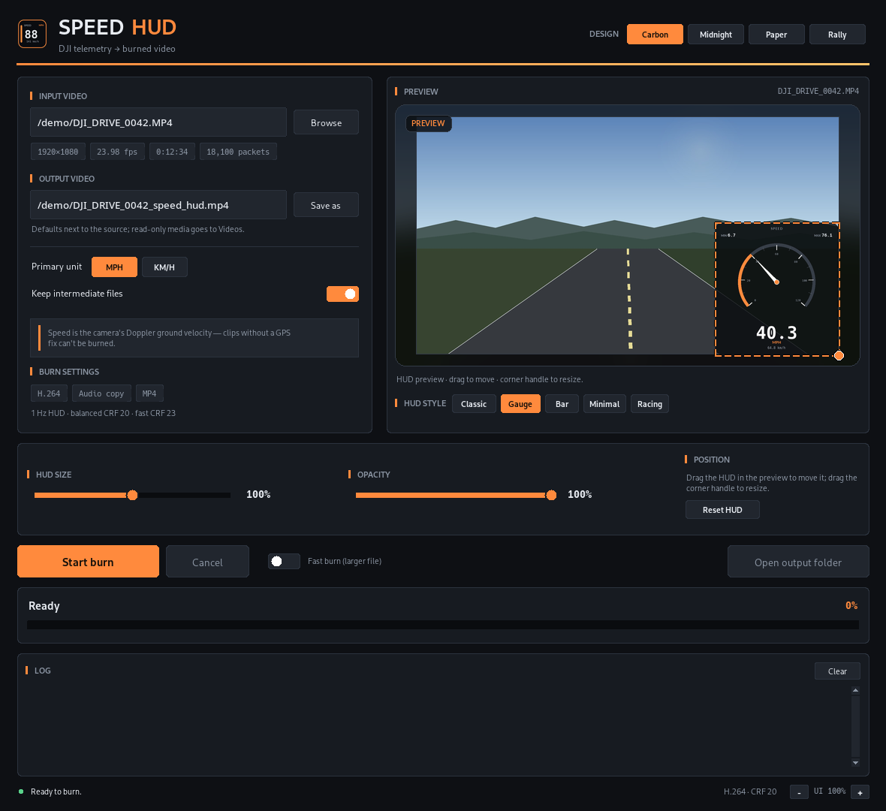
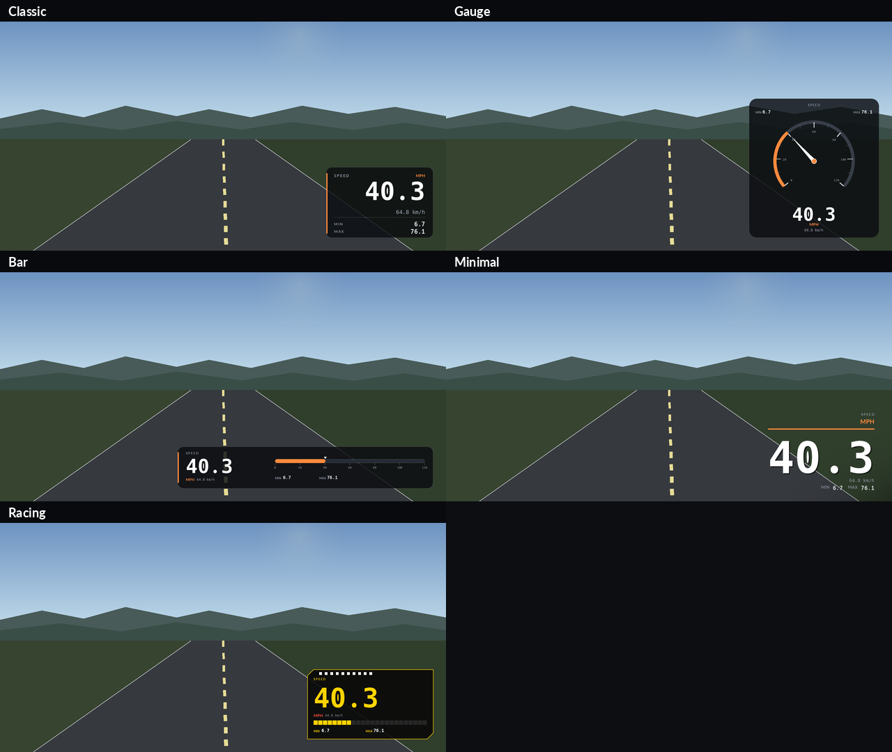

# Speed HUD

Burn a speedometer overlay onto DJI Osmo Action footage, using the camera's own
GPS/Doppler telemetry. Desktop GUI, live preview, five HUD designs, and free
drag/resize placement with adjustable opacity.



## HUD designs



| Style | Look |
|---|---|
| **Classic** | Compact bottom-right panel with current speed and session min/max |
| **Gauge** | Circular dial with needle, scale, and digital readout |
| **Bar** | Wide linear speed bar with scale, marker, and min/max |
| **Minimal** | Large floating number over a soft scrim, no panel |
| **Racing** | Cut-corner yellow digital panel with segmented bar and checkered strip |

All styles can be scaled 50–150%, faded 30–100%, and dragged anywhere in the
frame. Drag the HUD directly in the live preview to move it; drag the corner
handle (or use the size slider) to resize.

## Features

- Reads the `djmd` telemetry track embedded by DJI Osmo Action 4/5/6 cameras.
- Uses Doppler ground velocity — robust to GPS position noise and dropouts.
- Live preview from a real frame of the selected clip; switches to a frame from
  the finished video when the burn completes.
- mph or km/h as the primary unit.
- Four window themes: Carbon, Midnight, Paper, Rally.
- HiDPI-aware UI with manual UI scale control.
- Free HUD placement and resizing by direct manipulation in the preview.
- Cached preview compositing — dragging/resizing stays responsive even at 180% UI scale.
- Optional **Fast burn** (ultrafast / CRF 23). Roughly 1.5× faster than the
  balanced preset, at the cost of a noticeably larger MP4.
- Cancellable burn with progress, log, and configurable intermediate files.
- Windows, macOS, and Linux launchers.

## Requirements

- Python 3.10+ with Tkinter
- **FFmpeg / ffprobe** on `PATH`
- Python packages: `Pillow`, `numpy`, `pyosmogps`

The HUD fonts (Hack, Lato) are bundled under `assets/fonts/`, so the rendered
overlay looks the same on every OS.

### Linux

```bash
sudo apt install python3 python3-venv python3-tk ffmpeg
python3 -m venv venv
./venv/bin/pip install -r requirements.txt
./run_gui.sh
```

For a desktop-menu entry, create `~/.local/share/applications/speed-hud.desktop`
with the absolute paths on your machine:

```ini
[Desktop Entry]
Type=Application
Name=Speed HUD
Comment=DJI telemetry speedometer overlay
Exec=/absolute/path/to/run_gui.sh
Icon=/absolute/path/to/speedometer.png
Terminal=false
Categories=AudioVideo;Video;
```

### Windows

1. Install Python from <https://python.org> (the installer includes Tkinter).
2. Install FFmpeg: `winget install Gyan.FFmpeg`, then reopen the terminal.
3. In this folder:

```bat
py -m venv venv
venv\Scripts\pip install -r requirements.txt
run_gui.bat
```

### macOS

```bash
brew install ffmpeg python-tk
python3 -m venv venv
./venv/bin/pip install -r requirements.txt
./run_gui.command
```

If you use the python.org installer, Tkinter is already included. The `.command`
file is double-clickable after `chmod +x run_gui.command`.

## Usage

1. Click **Browse** and pick a DJI clip with telemetry and a GPS fix.
2. Pick a **HUD style** and **primary unit**, then drag the HUD in the preview to
   place it. Drag the corner handle or use the **HUD size** slider to resize, and
   set **Opacity** to taste. **Reset HUD** restores the defaults.
3. Choose the output path. Toggle **Fast burn** if encode time matters more than
   file size, then press **Start burn**.
4. The result is an MP4 with H.264 video (CRF 20), the HUD baked in, and the
   source audio copied when the container supports it.

Intermediates (packet index, `telemetry.csv`, `speed_1hz.csv`, HUD frames) go to
`<output>_work/`. Untick **Keep intermediate files** to delete them on success.

Keyboard: `Ctrl+O` open, `Ctrl+Enter` start, `Ctrl+=` / `Ctrl+-` UI scale.

## Notes and limitations

- Requires DJI `djmd` telemetry. Clips without it, or without a GPS fix, are
  rejected with a clear message.
- Designed for 16:9 footage. The HUD is rendered as a 1920×1080 overlay and
  scaled to the source width at burn time.
- The burn is decode-bound (10-bit HEVC), so `Fast burn` mainly trades file size
  for encoder time; the balanced default is CRF 20.
- The app is fully local; nothing is uploaded.
- Linux is the primary tested platform. Windows/macOS paths, fonts, launchers,
  and FFmpeg discovery are implemented, but those builds have not been run on
  physical Windows/macOS machines in this repository's development.
- The source video is never included; only derived frames/previews are shown.

## For maintainers

See [AGENTS.md](AGENTS.md) for the engineering handoff: pipeline internals, HUD
transform, UI scaling, the free drag/resize editor, testing commands, and
publishing rules.

## Credits

- [`pyosmogps`](https://github.com/francescocaponio/pyosmogps) by Francesco
  Caponio — DJI protobuf definitions and telemetry helpers.
- [Hack](https://github.com/source-foundry/Hack) — MIT / Bitstream Vera license.
- [Lato](https://www.latofonts.com) — SIL Open Font License 1.1.
- The bundled font license texts are in `assets/fonts/`.

## License

Code: MIT — see [LICENSE](LICENSE). Bundled fonts remain under their respective
licenses.
